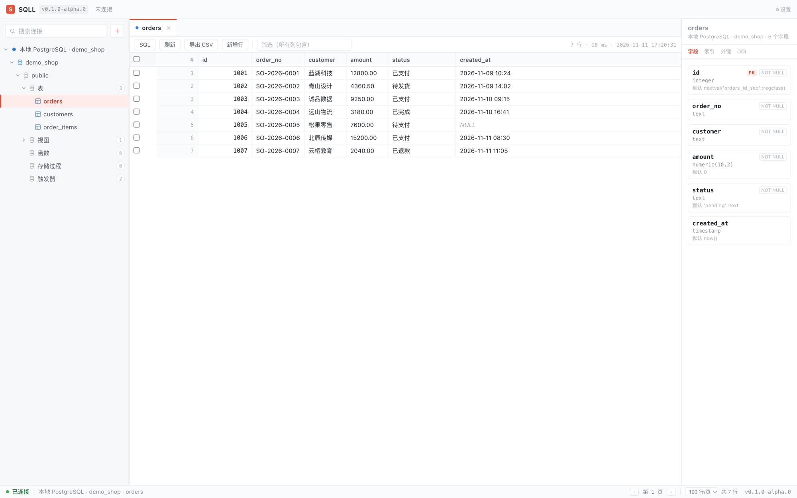
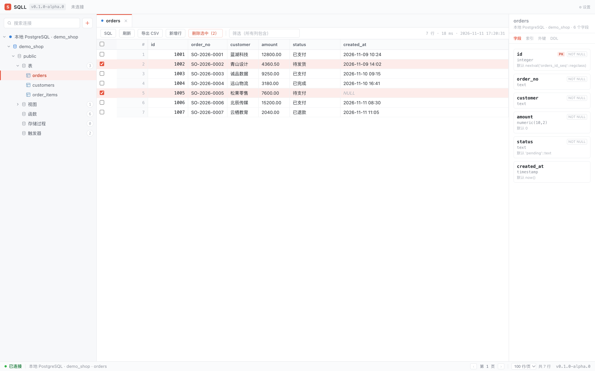
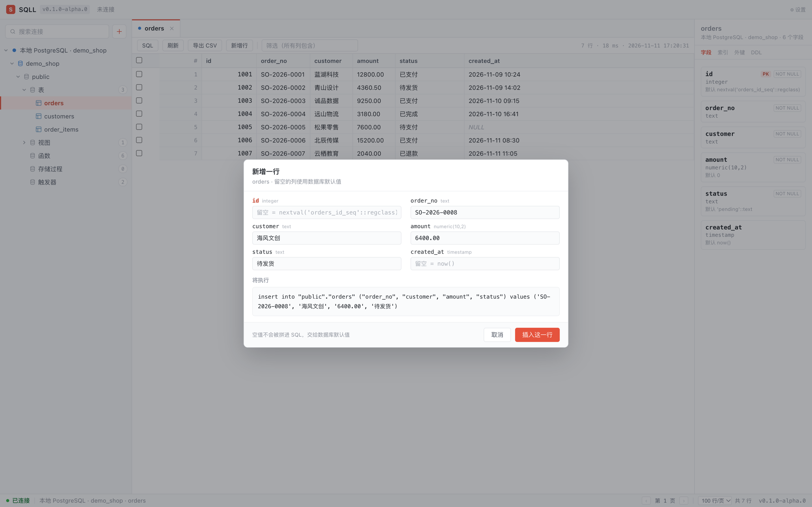
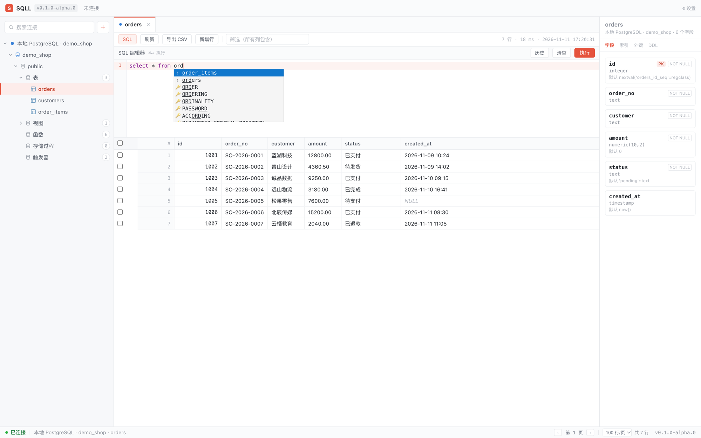
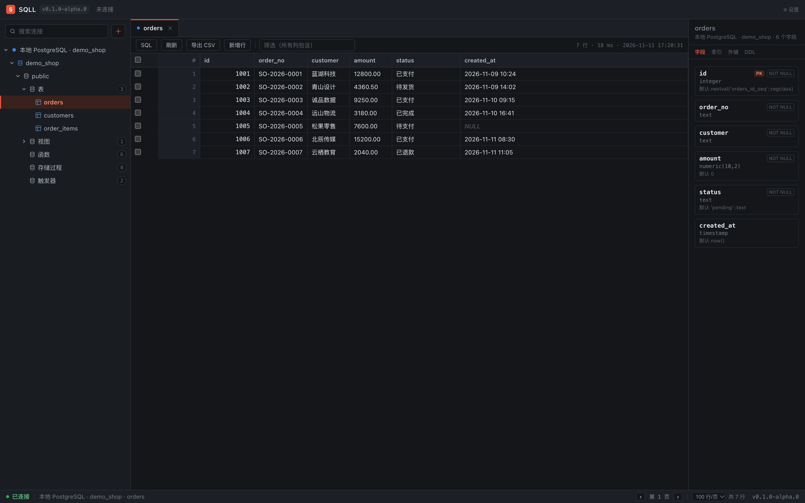
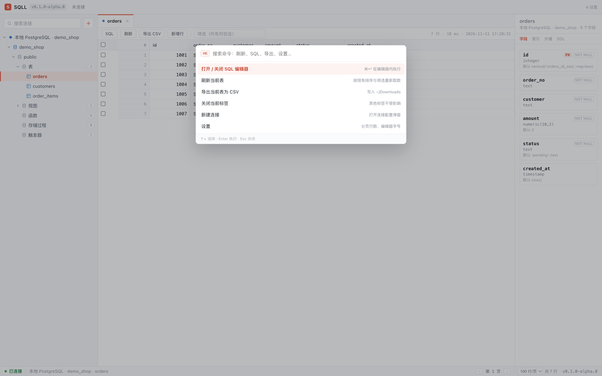
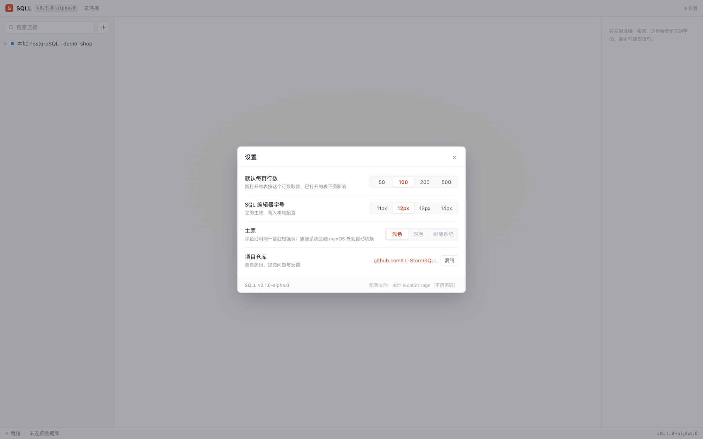

# SQLL

**一款轻量、专注「看数据、改数据」的跨平台桌面数据库管理工具。**

连上 MySQL / PostgreSQL / SQLite，左边展开库表结构，中间看数据、改单元格、跑 SQL、导出 CSV，
右边随时翻字段、索引与外键。装完就能用，没有示例库、没有账号体系、没有一堆用不上的面板。

<p>
    <a href="https://github.com/LL-Store/SQLL/issues">
        
    </a>
    <a href="https://github.com/LL-Store/SQLL" target="_blank">
        
    </a>
    <a href="https://github.com/LL-Store/SQLL">
        
    </a>
    
    
</p>

<a href="docs/screenshots/overview.png"></a>

三栏就是全部：**左边找表，中间看数，右边看结构**。不用记快捷键，也不用先学一套查询语言才能打开一张表。

## 为什么是 SQLL

- **一个界面，三种数据库。** MySQL、PostgreSQL、SQLite 共用同一套浏览、编辑、SQL、导出流程，换库不用换肌肉记忆。
- **动数据之前，先让你看见 SQL。** 改单元格、加一行、删一行、批量删，都会先弹出即将执行的语句；确认了才在事务里落库。
- **轻。** Tauri 2 打包的 `.app` 约 17.5 MB，启动就是一张表，不占内存也不催你登录。

## 界面里有什么

| 区域 | 能做什么 |
|---|---|
| 左侧结构树 | 服务器 → 库 → schema → 表 / 视图 / 函数 / 存储过程 / 触发器，懒加载，带搜索 |
| 中间标签栏 | 想开几张表就开几张，标签多了可以横向滚动，当前表始终在视野里 |
| 中间工具条 | 刷新、导出 CSV、新增行、批量删除、全列筛选、行数统计 |
| 数据网格 | 服务端分页、列头排序、单元格双击编辑、勾选行、超 200 行自动虚拟滚动 |
| 右侧面板 | 字段类型 / 可空 / 默认值 / 主键 / 注释、索引、外键、DDL |
| 底部状态栏 | 当前连接、当前表、分页信息、版本号 |

## 五个最常用的瞬间

### 1. 打开一张表，先看清楚它长什么样

选中表名，数据立刻铺开；点右边的「字段」能看到每一列的类型、默认值和注释，切到「索引」「DDL」还能直接复制建表语句。
分页在底部，列宽按内容自适应，`NULL` 用斜体标出来，不会和空字符串混在一起。

### 2. 批量删行：勾选、看语句、一次执行

表头可以一键全选本页，勾中的行立刻变成粉底 + 左侧强调条；工具条出现「删除选中（N）」。
点下去先看到 `delete ... where ("id"::text='1') or ("id"::text='2')`，确认后才真正删除。



删完右下角会浮出撤销条 —— 删除前整行已经拍成 `INSERT` 快照，点一下就能原样插回（保留最近一次，10 秒后自动收起）。

### 3. 新增一行：留空就交给数据库

按字段元数据生成表单，留空的列不会拼进 SQL：自增走序列、有默认值走默认值、可空的给 `NULL`。
输入时实时预览将要执行的 `INSERT`，不用先背语法。



### 4. SQL 编辑器：方言、补全、多语句

CodeMirror 6 按连接类型切方言，补全覆盖整个 schema —— 输入 `select * from ord` 就会浮出 `orders`、`order_items`。
`⌘↵`（Windows 为 `Ctrl+Enter`）执行；一次可以贴多条语句，按顶层 `;` 拆分，字符串、注释、`$$` 里的分号不会被误切，遇错即停并回滚。
查询回显列与行，写语句回显影响行数；跑偏了可以点「停止」。



### 5. 深色模式，不是简单反色

所有颜色都收在 `src/styles/tokens.css` 的令牌里，深色只换一套变量：底色压到 `#14161a`，选中行变成暗红底 + 橙字，编辑器跟着一起切，不用重建实例。
主题三档：浅色 / 深色 / 跟随系统。



### 顺手就能用的两个小东西

<table>
<tr>
<td width="50%"><br><b>⌘K 命令面板</b>：刷新、导出、开关 SQL、关标签、新建连接，键盘直达。</td>
<td width="50%"><br><b>设置</b>：默认每页行数、编辑器字号、主题三档，以及项目仓库入口。</td>
</tr>
</table>

## 数据库支持

| 能力 | MySQL | PostgreSQL | SQLite |
|---|:--:|:--:|:--:|
| 连接 / 测试 / 库列表 | ✅ | ✅ | ✅（按文件） |
| 表 / 视图 / 函数分组 | ✅ | ✅ | ✅ |
| 字段元数据（含主键） | ✅ | ✅ | ✅ |
| 数据分页 / 排序 / 筛选 / 总数 | ✅ | ✅ | ✅ |
| 索引 / 外键 / DDL | ✅ | ✅（DDL 为拼装） | ✅ |
| 单元格编辑 / 新增行 / 删除 / 撤销 | ✅ | ✅ | ✅ |
| 多语句执行 / 停止查询 | ✅ | ✅ | ✅（停止不支持） |
| CSV 导出 | ✅ | ✅ | ✅ |
| 实连验证 | MySQL 9.7.1 | PostgreSQL 18.4 | 单测内建库 |

## 快捷键

| 操作 | macOS | Windows / Linux |
|---|---|---|
| 命令面板 | `⌘K` | `Ctrl+K` |
| 执行 SQL | `⌘↵` | `Ctrl+Enter` |
| 关闭弹窗 / 菜单 | `Esc` | `Esc` |

## 快速开始

环境要求：Node.js 18+、Rust（stable）、Tauri 2 的平台依赖（macOS 需 Xcode Command Line Tools，Windows 需 MSVC 工具链与 WebView2）。

```bash
npm install          # 安装依赖
npm run dev          # 仅前端，http://localhost:1420
npm run app:dev      # 起 Tauri 桌面窗口（会自动拉起前端）
```

构建与打包：

```bash
npm run build                    # 生产构建前端到 dist/
npx tauri build --no-bundle      # 只出 release 可执行文件
npx tauri build --bundles app    # macOS 出 SQLL.app（未签名）
npx tauri build                  # 按 bundle.targets = "all" 出安装包
```

版本号只改 `package.json`，`predev` / `prebuild` 已挂 `npm run version:sync`，会自动同步到 `tauri.conf.json` 与 `Cargo.toml`。
应用内的仓库地址也从 `package.json` 的 `repository` 字段构建时注入，不需要第二处维护。

### Windows 打包

支持，但**不能在 macOS 上交叉编译**，需要在 Windows 机器或 Windows CI 上执行：

1. 安装 Rust（MSVC toolchain）与 Visual Studio C++ Build Tools；
2. 确认 WebView2 Runtime（Win10 1803+ / Win11 自带）；
3. `npm install && npx tauri build`，产出 NSIS `.exe` 与 MSI。

未签名的安装包首次运行会触发 SmartScreen「未知发布者」，需要用户手动放行。

## 技术栈

- 桌面壳：Tauri 2（Rust，`src-tauri`）
- 前端：webpack 5 + React 18 + TypeScript，`swc-loader` 编译，CSS Modules + CSS 变量令牌
- 数据库驱动：sqlx 0.8 的 `Any` 驱动（runtime-tokio + mysql / postgres / sqlite + tls-rustls）
- 状态：zustand；编辑器：CodeMirror 6；右键菜单 / 弹窗 / Tab 全部自研，不引组件库

## 目录结构

```
src/
  components/     # 界面组件，每组件配同名 .module.css
    TitleBar / Sidebar / WorkArea / Inspector / StatusBar
    ConnectionDialog / SettingsDialog / UpdateDialog / CommandPalette
    ContextMenu / SqlEditor / Icons
  store/          # zustand：多 Tab、结构树、设置、SQL 历史
  services/       # ipc.ts：Tauri 命令封装
  styles/         # tokens.css（设计令牌，改主题只改这里）+ global.css
  types.ts        # 跨层类型，与 Rust serde 结构一一对应（camelCase）
src-tauri/
  src/lib.rs      # Tauri 命令注册
  src/db.rs       # 三驱动通用取数 / 元数据 / UPDATE / CSV
  src/store.rs    # 连接配置文件 + 系统钥匙串
  src/model.rs    # 跨层数据结构
scripts/          # sync-version.mjs
docs/             # 截图与实现细节（implementation-notes.md）
```

## 设计约定

- **令牌驱动**：颜色、尺寸、字体都在 `src/styles/tokens.css`，组件里不写死色值。
- **选中行**：粉底 `#FDECEA` + 暗红字 `#C4402B` + 左侧 2px 强调条。
- **右键菜单**：自研组件（屏蔽 webview 系统菜单），常用项在前，危险项沉底标红。
- **只读 / 生产**：只读连接由后端拒绝写入；生产连接的写操作弹窗必须二次勾选确认。
- **空态**：首次启动没有任何示例库，左栏与主区都给「新建连接」入口。

## 已知限制

- 多语句按顺序执行：多条查询只展示最后一条的结果集，前面的结果不保留
- 停止查询：PostgreSQL 走 `pg_cancel_backend`、MySQL 走 `KILL QUERY`（需要相应权限）；
  SQLite 没有可中断的独立后端，按钮会明确提示不支持
- CSV 固定落 `~/Downloads`，没有保存对话框
- 新增行 / 删除行按字面量拼 `SQL`（值走 `''` 转义），不支持二进制或含换行的超长内容粘贴
- 撤销删除靠内存快照，只覆盖最近一次；应用重启后失效，删除后改过表结构也可能恢复失败
- MySQL 的 `show create function / procedure` 需要对应权限，无权时会如实报错
- 单元格编辑不支持二进制列；`vector` 等自定义类型可能被数据库拒绝（会如实报错）
- `.app` 未签名未公证，分发到其他机器需要自行签名
- 主题有浅色 / 深色 / 跟随系统三档，跟随系统只跟随系统外观，不能按时段自定义
- 虚拟滚动行高固定 26px
- 快捷键文案目前统一显示 `⌘`，Windows 上按 `Ctrl` 同样生效

## 开发校验

```bash
npx tsc --noEmit                  # 类型检查
npm run build                     # 前端构建
cd src-tauri && cargo build       # Rust 构建
cd src-tauri && cargo test        # SQLite 全链路测试
SQLL_TEST_PG=1 cargo test         # 追加连本机 PostgreSQL 的探针
SQLL_TEST_MYSQL=1 cargo test      # 追加连本机 MySQL 的探针（默认 3307 端口）
```

## 版权

MIT License

Copyright (c) [zxl20070701](https://zxl20070701.github.io/notebook/home.html) 走一步，再走一步
